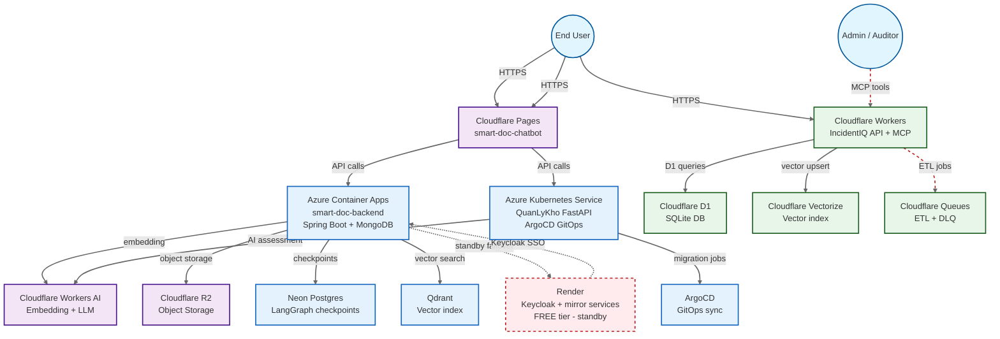

# Architecture Diagram — Multi-Cloud System Design

Generated: 2026-11-12
Format: Mermaid

## Cloud Responsibilities

| Cloud | Role | Services | SLA Tier |
|-------|------|----------|----------|
| **Azure** | Canonical backend | Container Apps, AKS, Neon Postgres, Qdrant | Production (paid) |
| **Cloudflare** | Edge + AI | Pages, Workers AI, R2, Workers, D1, Vectorize, Queues | Production (paid/free) |
| **Render** | Standby mirror | Keycloak, legacy services | Free (standby only) |
| **Neon** | Managed Postgres | LangGraph checkpoints, QuanLyKho metadata | Production (paid) |

## Data Flow — RAG Query

1. User → Cloudflare Pages (frontend)
2. Pages → Azure Container Apps API (`/api/rag/chat`)
3. Backend → Qdrant (vector search) + Workers AI (embedding/LLM)
4. Backend → Neon Postgres (LangGraph checkpoint, HITL pause/resume)
5. Backend → R2 (document storage, signed URLs)
6. Response → Pages → User

## Data Flow — HITL Approval

1. Action agent → HITL gate → pause workflow
2. Checkpoint stored in Neon Postgres (shared, survives redeploy)
3. Admin approves via `POST /agent/approvals/{id}/approve`
4. Workflow resumes from checkpoint, executes action

## Failure Modes

| Scenario | Behavior |
|----------|----------|
| Azure API down | Render standby (manual failover, documented) |
| Redis down | HITL fail-closed — actions blocked, reads continue |
| Qdrant down | RAG returns degraded fallback (keyword search) |
| Render free spin-down | No impact — Azure is canonical; Render is standby only |
