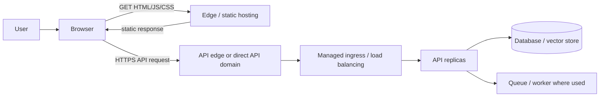

# System Design — Enterprise AI Automation Platform

Generated: 2026-11-12
Scope: Enterprise RAG, IncidentIQ, QuanLyKho, Flash Sale, CreditFlow (5 projects)

## 0. Browser-to-server request paths (verified 2026-11-17)

The static frontend delivery path and business API path are separate. A CDN
serving JavaScript does not imply that API traffic passes through the same CDN
or through a dedicated load balancer. Treat provider-managed ingress as a
platform boundary unless its topology and replica count are verified in the
provider dashboard.

For Enterprise RAG and IncidentIQ, `X` is the same-origin Worker/Function.
For Flash Sale, CreditFlow and QuanLyKho, the browser calls a separate API
origin, so browser CORS and API DNS are release-critical. The `I` box denotes
the hosting platform's ingress; a separate customer-managed load balancer has
not been demonstrated by these public routes.

| Project | Frontend path | API path configured in source | Public observation | Production boundary |
|---|---|---|---|---|
| Flash Sale | Browser → Cloudflare Pages | Browser → Render web service; separate AKS/Application Gateway ingress manifest exists | Pages 200; live bundle pointed at `localhost:8081`; Render preview health timed out | Cloudflare release gate now checks the deployed bundle's API URL. Re-deploy and verify Render before claiming an end-to-end route. |
| CreditFlow | Browser → GitHub Pages | Browser → Azure Container Apps API, FQDN emitted by Azure deploy | Pages 200; deployed bundle's Azure hostname did not resolve; documented Azure hostname also did not resolve | CD now checks that the built and deployed bundle contains the FQDN returned by Azure. No bank IdP or real credit decision is connected. |
| Enterprise RAG | Browser → Cloudflare Pages | Browser → same-origin Pages Function `/api` → Azure Container Apps API | Pages 200; `/api/actuator/health` returned 530; configured Azure hostname did not resolve | Pages release gate now requires the proxy health path. Existing Kubernetes ingress manifests do not prove an active cluster. |
| IncidentIQ | Browser → Cloudflare Worker static assets | Browser → same Worker `/api/*` → D1, Vectorize and queue; MCP Worker uses service binding | Live `/health` returned 200 but `/` returned 404; selective asset routing fixed locally and verified with Wrangler (`/` 200, `/app.js` 200, `/health/live` 200) | Production workflow now checks browser assets after deployment. Remote fix is unverified until the release runs. |
| QuanLyKho | Browser → Cloudflare Workers Assets | Browser → Modal FastAPI endpoint | Frontend and Modal readiness both returned 200; live Flutter bundle contained the configured Modal URL | Deploy workflow now checks the browser bundle target. Kubernetes/AKS manifests are an alternate topology, not evidence of the Modal route. |

### Interview explanation and production acceptance

For each project, draw two arrows: `Browser → edge/static host → JS/CSS` and
`Browser → API hostname → platform ingress/LB → API instance(s) → data services`.
Name the TLS termination point, CORS or same-origin proxy, authentication
boundary, health route, and failure response. Flash Sale additionally sends
accepted orders through Redis admission, queue and worker to the authoritative
database; CreditFlow's API performs scoring and protected review; Enterprise
RAG's Pages Function forwards to the backend and agent; IncidentIQ uses Worker
bindings; QuanLyKho uses a direct Modal API origin.

Before calling any of these a production service, record a successful browser
business flow through the public frontend, the deployed source SHA and API
target, provider ingress/replica settings, an authenticated negative access
test, p95/p99 load results, alert routing, and a restore or failover drill with
measured RPO/RTO. Do not claim a separate CDN, WAF or load balancer where the
configuration or provider dashboard does not show one. The 2026-11-17 public
checks above are point-in-time observations, not an availability SLO.

The authenticated Azure subscription inspected on 2026-11-17 contained no
Container Apps, including in `rg-portfolio-prod`. Thus the Enterprise RAG and
CreditFlow Azure origins cannot be restored by changing frontend URLs alone;
the API workloads, required secrets and ingress must be deployed and verified
first. Flash Sale's Render preview `/health/live` returned 200 after a cold
start and its browser CORS preflight allowed the preview Pages origin, while
the named Render production endpoint returned 404. These are release blockers,
not missing arrows to add to a diagram.

## 1. Design Goals

| Goal | Rationale |
|------|-----------|
| Production SLA | 99.9% uptime for backend APIs (Azure/AKS + Cloudflare) |
| Multi-cloud resilience | Azure canonical backend; Cloudflare edge/AI; Render as documented standby |
| Data durability | LangGraph checkpoints in Neon Postgres (survives redeploy); HITL fail-closed |
| Security | No hardcoded secrets; env vars / secret manager; input validation at boundary |
| Observability | Health endpoints, smoke tests, uptime alerts, cost dashboards |

## 2. Decision Trade-offs

### 2.1 Azure for Canonical Backend
**Chosen:** Azure Container Apps (Enterprise RAG) + AKS (QuanLyKho)
**Reasons:**
- Managed platform, no server management
- Integrated with Neon Postgres, Qdrant, Keycloak
- Production SLA available
- Existing CI/CD (`deploy-azure.yml`) already validated

**Rejected:** Render as canonical — free tier spin-down causes 502 (G3), intermittent downtime (G2)

### 2.2 Cloudflare for Edge + AI
**Chosen:** Cloudflare Pages (frontend), Workers AI (embedding/LLM), R2 (storage), Workers (IncidentIQ API)
**Reasons:**
- Edge proximity to users
- Workers AI provides GPU-accelerated inference without managing infra
- R2 has no egress fees
- Workers provides isolated D1/Vectorize per environment (preview vs prod)

**Rejected:** Vercel/Netlify — no native Workers AI integration, higher egress costs

### 2.3 Neon for LangGraph Checkpoints
**Chosen:** Neon Postgres (serverless, auto-suspend)
**Reasons:**
- Shared checkpoints across replicas (HITL persistence)
- Survives redeploy (unlike SQLite ephemeral disk)
- Fail-closed option via `LANGGRAPH_CHECKPOINT_SHARED_REQUIRED`

**Rejected:** SQLite on ephemeral disk — checkpoints lost on every redeploy (G4)

### 2.4 Qdrant for Vector Search
**Chosen:** Qdrant (managed cloud)
**Reasons:**
- Purpose-built vector database
- HNSW indexing, filtering, payload storage
- Integrates with Azure backend

**Rejected:** pgvector — sufficient for small scale, but Qdrant better for production vector search at scale

## 3. Per-Project Design Summary

### 3.1 Enterprise RAG
| Component | Choice | Status |
|-----------|--------|--------|
| Frontend | Cloudflare Pages | Not yet published (G1) |
| Backend | Azure Container Apps | Canonical (P1.3) |
| Auth | Keycloak | Render free down (G2) — needs migration |
| Checkpoints | Neon Postgres | Configured, needs DATABASE_URL secret |
| HITL | Redis Upstash + fail-closed | Configured, test written (P1.5) |
| Eval | Live benchmark | Not yet run (P1.6) |

### 3.2 IncidentIQ
| Component | Choice | Status |
|-----------|--------|--------|
| API | Cloudflare Workers | CI/CD configured (deploy-preview/prod) |
| Database | Cloudflare D1 | Isolated preview/prod |
| Vector | Cloudflare Vectorize | Isolated preview/prod |
| ETL | Cloudflare Queues + DLQ | Retry + dead-letter tested (P2.3) |
| Tenant isolation | API key hash binding | Tests written (P2.2) |
| Frontend auth | Not complete (G7) | Needs implementation |

### 3.3 QuanLyKho
| Component | Choice | Status |
|-----------|--------|--------|
| Frontend | Cloudflare Pages / Workers Assets | Preview domain (G8) — needs production domain |
| Backend | Render preview → Modal (actual) | Reconcile render.yaml vs Modal (P3.2) |
| AI provider | `disabled` → `cloudflare` | Config changed (P3.3), needs secret |
| AI integration | Cloudflare Workers AI / Ollama | Code exists in `services/ai.py` |
| E2E tests | 355 tests | 531 passed locally (P3.5) |
| ArgoCD | GitOps migration job | Needs cluster access (P3.6) |

## 4. Security Model

| Layer | Control |
|-------|---------|
| Secrets | `.env.example` placeholders only; real values in Render dashboard / GitHub Secrets / `wrangler secret put` |
| Input validation | Spring validation (backend), Pydantic schemas (QuanLyKho), Zod (IncidentIQ MCP) |
| Auth | Keycloak OIDC (Enterprise RAG), API key hash binding (IncidentIQ), session binding (QuanLyKho) |
| Tenant isolation | DB-level `tenant_id` filtering on every query |
| Secrets scan | TruffleHog + gitleaks + Trivy in CI (blocking) |
| Error handling | No silent swallows; server-side detailed logs, client-safe messages |

## 5. Observability

| Signal | Tool | Status |
|--------|------|--------|
| Health checks | `/api/actuator/health`, `/health/live`, `/health/ready` | Implemented |
| Uptime monitoring | To be configured (P1.7) | Pending |
| Cost dashboard | To be configured (P2.6) | Pending |
| AI latency | Langfuse traces | Implemented (QuanLyKho) |
| Smoke tests | CI + browser auth | Azure evidence collected (P1.8) |

## 6. Remaining Gaps (Deploy-Blocked)

| # | Gap | Required |
|---|-----|----------|
| G1 | Publish Cloudflare Pages | `CLOUDFLARE_API_TOKEN` + `CLOUDFLARE_ACCOUNT_ID` GitHub Secrets |
| G2 | Fix Keycloak `$PORT` binding | Render/Azure deploy access |
| P1.1 | Publish frontend to Cloudflare Pages | Credentials above |
| P1.6 | Live RAG benchmark | Qdrant + LLM provider credentials |
| P1.7 | Monitoring & alerting | Azure Monitor / uptime provider |
| P2.1/P2.5 | IncidentIQ preview/prod deploy | Cloudflare API tokens |
| P3.1/P3.2 | QuanLyKho production domain + backend | Cloudflare + Render/Modal access |
| P3.6 | ArgoCD GitOps production | AKS cluster access |

## 7. Handoff Package

All documentation consolidated in `docs/production-readiness/`:
- `AZURE_SYSTEM_DESIGN_EVIDENCE.md` — Azure smoke test results
- `ARCHITECTURE_DIAGRAM.md` — Multi-cloud Mermaid diagram
- `COST_ANALYSIS.md` — Free vs paid tier comparison
- `SYSTEM_DESIGN.md` — This document (trade-offs, decisions)
- `SECRET_INVENTORY.md` — Secret sources (no values)
- `CI_AUDIT.md` — CI/CD workflow analysis
- `CONTRIBUTING.md` — ECC conventions (TDD, immutability, coverage, commits)
